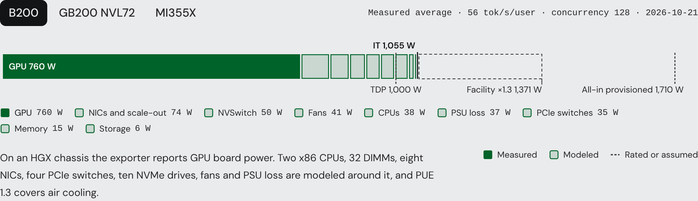
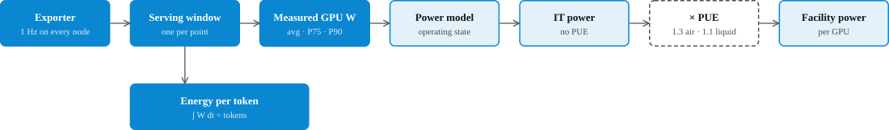
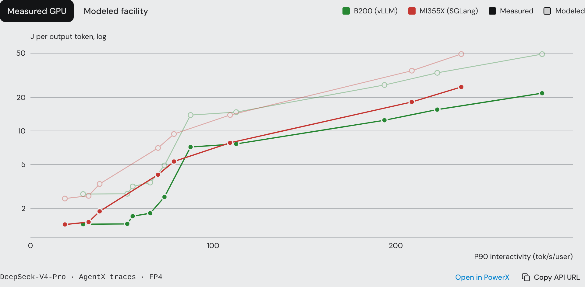
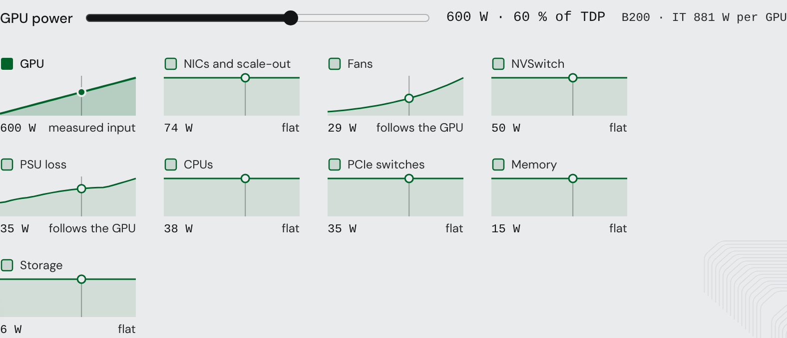
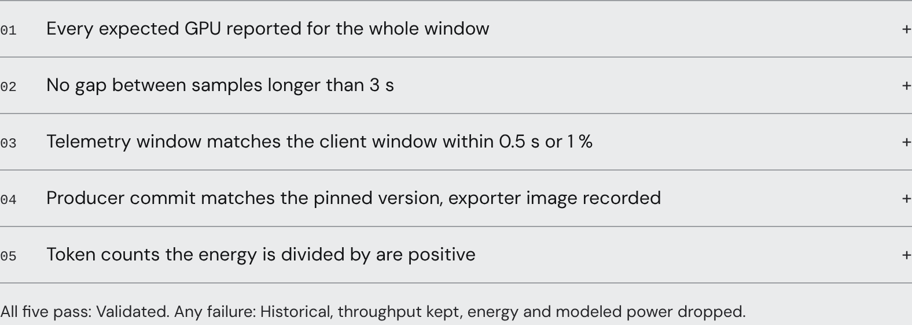
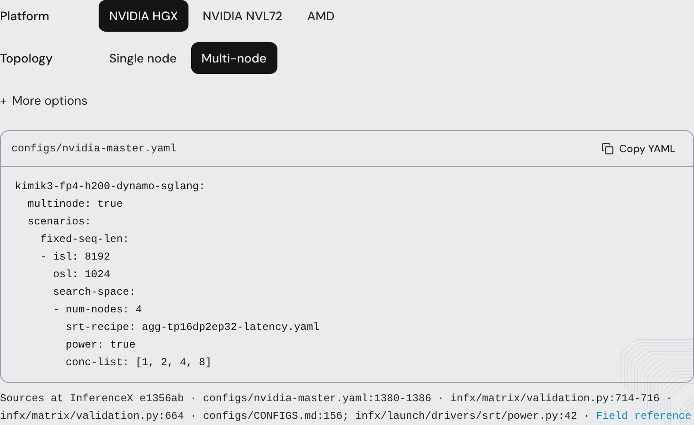
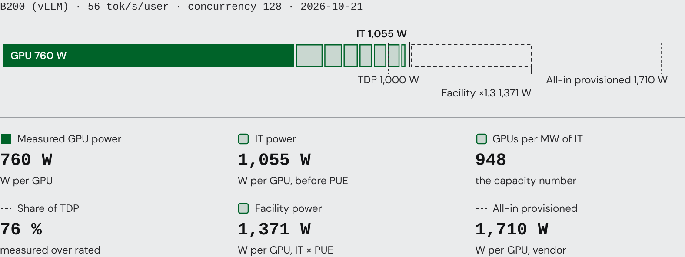

PowerX measures what each accelerator draws while it serves a benchmark and models the rest of the system around it. Solid marks are measured telemetry, outlined marks are modeled by the open-source power model, dashed marks are rated or assumed values. The grammar holds on every chart.

## From measurement to modeled power

- **Sampled.** `dcgm-exporter` on NVIDIA nodes and `device-metrics-exporter` on AMD nodes report every GPU once a second; the head node scrapes every node on one clock.
- **Windowed.** Each concurrency point has one serving window, from the end of warmup to the last request. Only samples inside it count.
- **Integrated.** Energy per GPU is the trapezoid integral of its samples over the window; energy per token divides the deployment's GPU energy by the tokens the client counted.
- **Modeled.** The `power_model` package takes the measured watts and an operating state (fixed sequence, agentic, agentic with KV offload), adds CPUs, memory, NICs, switches, storage, fans and PSU loss to reach IT power, then applies PUE (1.3 for an air-cooled chassis, 1.1 for a liquid-cooled NVL72 rack) for facility power.

> [!NOTE]
> Measured watts cover the accelerator only: the GPU board on HGX systems, the GPU module on NVL72, the GPU package on AMD. On NVL72 the Grace socket is measured too when its window passes the Grace check. Nothing modeled is stored; it is recomputed from the stored GPU samples at a pinned model revision, so a model change moves every point at once.

## Explore PowerX

The modeled curve sits above the measured one with the same shape, because the parts the model adds barely move with load.

Lower is better, and both lines are Pareto frontiers against interactivity like the rest of the dashboard.

Move the GPU from idle to TDP to see which modeled parts follow it.

Fans and PSU loss track the GPU; CPUs, memory, NICs and switches hold their level, so a lightly loaded GPU carries the largest overhead in relative terms.

## Methodology

Average, P75 and P90 power are time-weighted over the window across every GPU in the deployment; prefill and decode roles are averaged over the same window. Planners read **P90**, because dynamic power steering reacts to peaks; chip comparisons read **energy per token**.

A point is **Validated** only when the offline validator, re-run from the raw samples, passes all five checks. Anything else is **Historical**: throughput stays, energy and modeled power are dropped, and the audit record names the failing check.

Power collection is part of every official sweep, so a submitted recipe is measured automatically. To run it yourself, add `power: true` to a multi-node matrix entry; single-node and AgentX jobs use the cluster's native exporter. `require-power` (or `REQUIRE_POWER=1`) fails the job on an invalid window instead of recording `power_valid: 0`.

The aggregate JSON carries `power_valid`, `avg_power_w`, `p90_power_w` and the `joules_per_*` metrics; the `power_audit_<result>` artifact holds `samples.csv`, the window files and `power_validation_<result>.json`.

> [!IMPORTANT]
> AMD's exporter reports package power and NVIDIA's reports board or module power, so cross-vendor comparisons should say so. AgentX points use the model's agentic state, which has not been calibrated against measured system power.

## Apply the results

One validated point, read the way a capacity plan reads it: measured watts, the IT watts the model adds, GPUs per megawatt, and the rated marks it sits under.

Open [PowerX](/inference?i_metric=y_measuredAvgPower), pull the same numbers from the [API](/api), or run `inferencex powerx export` from the [skills package](https://github.com/SemiAnalysisAI/InferenceX-app/tree/main/packages/skills).

## FAQ

Why is measured power so far below TDP?

Decode-heavy inference is bound by memory and latency targets, not by compute, so the GPU rarely reaches its power limit. Prefill, video generation and training sit close to TDP.

Do DCGM and nvidia-smi disagree?

No. Both read the same NVML sensor, and the firmware already averages over roughly a second, which is why sampling faster than 1 Hz adds little. DCGM adds a daemon and an energy counter.

Why P90 rather than average?

Capacity is provisioned for peaks. P90 is the power exceeded for 10 % of the window and is what a buffer should be added to.

Why offer IT without PUE?

Data-center capacity teams size on critical IT kW per GPU. PUE depends on the site, so Facility applies it separately.

What happens when the power model changes?

Nothing is stored. Every modeled number is recomputed from the stored GPU measurements with the pinned model revision, so an update changes every point at once and the revision is shown in the tooltip.

Why is one point Historical when the rest of the run is Validated?

Validity is per window. One lost sample or a clock mismatch invalidates that window only; the point keeps its throughput and loses its energy.

Does a higher Facility number mean the site is less efficient?

No. PUE is a fixed model input per cooling type, not a measurement of the benchmark site.

